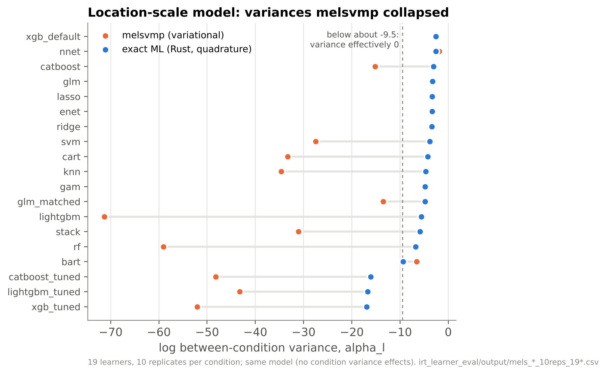

# mels_quad: what the Rust fit changed

Eliot R. Weinstein · eliotw@uchicago.edu · erweinstein.com · 18 November 2026

`mels_quad` fits the mixed-effects location-scale model of `R/04_mels_volatility.R` (Hedeker, Mermelstein and
Demirtas 2008) by exact maximum likelihood. `R/04c_mels_quad.R` runs it and reads its output; `FLAGS.md` item 26
has the full results.

## The model

For replicate r of condition c and learner l:

- Level 1 (replicate): y_rcl = β_l + β_c + ν_cl + e_rcl,  e_rcl ~ N(0, exp(τ_l + γ_c + ω_cl))
- Level 2 (learner-by-condition cell): ν_cl ~ N(0, exp(α_l)),  ω_cl ~ N(0, σ_ω²)
- Combined: y_rcl = β_l + β_c + ν_cl + exp{(τ_l + γ_c + ω_cl)/2} u_rcl,  u_rcl ~ N(0, 1)

melsvmp's model has γ_c = 0.

## Why an exact fit

melsvmp fits this model by variational message passing (Wu and Hedeker 2026), which is mean-field: the
factorized posterior understates posterior variance. On these data it put 11 of the 19 learners' between-condition
log variances α_l at −13.5 to −71.3, effectively zero.

The exact fit integrates the location effect ν out in closed form given the scale effect ω. A cell's replicates
are multivariate normal with covariance s²I + v11′, so the cell log-likelihood needs only the replicate count R,
the mean ȳ and the within-cell sum of squares SSW:

l(ω) = −(R/2) log 2π − ((R − 1)/2) log s² − ½ log(s² + Rv) − SSW/(2s²) − R(ȳ − μ)²/(2(s² + Rv)),

where s² is the level-1 variance given ω, v = exp(α_l) and μ = β_l + β_c. Only the one-dimensional integral
over ω is numerical: a 241-point trapezoid rule in z = ω/σ_ω, accurate to far below the optimizer's tolerance for
this smooth integrand. The gradient is analytic, as posterior expectations over the grid (Fisher's identity,
∇ log ∫ f = E_post[∇ log f]). The optimizer is L-BFGS (Liu and Nocedal 1989) with a backtracking line search, and a
smooth floor at α = −20 lets a boundary estimate settle instead of drifting.

## What it showed

- Exact ML gives clearly nonzero between-condition variances for 16 of the 19 learners (α_l from −2.5 to −9.4).
  Only the three tuned boosters go to the boundary (α_l about −16 to −17). Where melsvmp did not collapse, the two agree within 0.1–0.8 on
  α_l, and σ_ω agrees (2.15 against 2.17). So the collapse is melsvmp's algorithm, not the model.
- A variance level for each condition (γ_c, which melsvmp cannot fit) raises the log-likelihood from 15,989.9 to
  16,738.4 (likelihood ratio 1,497 on 52 df) and cuts σ_ω from 2.15 to 0.89.

## What Rust contributed

Rust's part was to make an exact fit cost about 5 minutes. The likelihood is parallelized over cells with rayon,
which runs work only on types the compiler can prove safe to share (Jung et al. 2018). The per-cell terms are
collected before they are summed in a fixed order, so the objective is bit-for-bit the same on any number of
threads. The fit offers a bootstrap that resamples conditions (`MELS_QUAD_B`).

## Possible problems

- **Exact is not fast.** The fit takes about 8.5 times as long as melsvmp (297 s against 35 s). Its value was
  correctness, not speed.
- **Not compared with C++.** For three other kernels in my projects, line-for-line Rcpp ports ran within a
  factor of 2.3 of the Rust versions, and faster on two. So an Rcpp version of this fit would probably be about
  as fast; I have not written one.
- **Not done:** standard errors by the condition bootstrap, and a profile likelihood for the three boundary α_l.

## References

- Hedeker, D., R. J. Mermelstein and H. Demirtas (2008). An application of a mixed-effects location scale model for
  analysis of ecological momentary assessment (EMA) data. *Biometrics* 64, 627–634.
- Jung, R., J.-H. Jourdan, R. Krebbers and D. Dreyer (2018). RustBelt: securing the foundations of the Rust
  programming language. *Proceedings of the ACM on Programming Languages* 2(POPL), article 66.
  doi:10.1145/3158154
- Liu, D. C. and J. Nocedal (1989). On the limited memory BFGS method for large scale optimization. *Mathematical
  Programming* 45, 503–528.
- Wu, B. P.-H. and D. Hedeker (2026). Fast estimation and valid statistical inference for mixed-effect
  location-scale models using variational inference. *Statistics in Medicine* 45, e70640.
